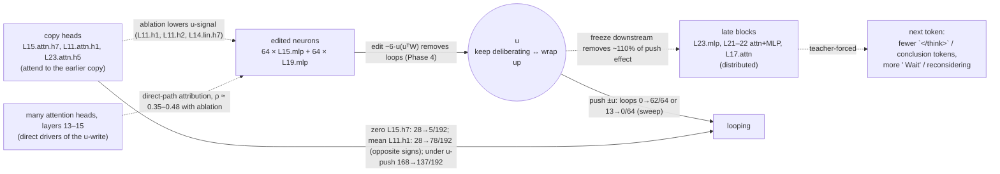

# Level 4: the looping circuit in Qwen3.5-0.8B

**Question:** which components carry the loop on real text? That means what drives the edited neurons' push along u, how u reaches the prediction, and which heads copy earlier text.

**Setup:**
- Code: `src/probe/circuit.py`, stages `attn → upstream → downstream → ablate → confirm`. Data: `08_circuits/looping/`.
- Teacher-forced stages use the saved Phase 4 generations: 13 looping base answers plus 13 length-matched non-looping ones.
- Generation tests use the same 64 problems, seeds and 4K cap as Phase 4.

## Summary
1. **u is a "keep deliberating vs wrap up" axis, not a copy signal.**
   - Pushing toward its loop side cuts P(`</think>`) about 4–5× and raises reconsidering tokens (" Wait", 不是, 还是, 有没有, 能不能).
   - It lowers concluding ones (便可, " yielded", "/results").
   - It slightly *lowers* the probability of the exact copied token.
   - Loops are a downstream consequence of not concluding.
2. **u acts entirely through later components, spread across the last layers.**
   - Freezing everything downstream removes all of the push's effect on P(`</think>`). The largest single block is L23's MLP.
   - No single neuron carries more than 2%, including the wiring map's top static readers of u.
3. **Copy heads exist, and the head Sparks zeroed is one of them.**
   - L11.attn.h1 and L15.attn.h7 attend to the token after the earlier copy at 167× and 136× uniform.
   - L15.attn.h7 is the head Sparks' p25c run zeroed. On a synthetic repeated sequence it puts 99% of its attention there.
4. **Individual copy heads have strong, reproducible, but opposite effects on looping in free generation.** Pooled over three seed sets, 192 answers per condition:
   - Zeroing L15.attn.h7 (exactly Sparks' p25c edit) cuts loops from 28/192 to 5/192 (p = 3 × 10⁻⁵), in every seed set.
   - Mean-ablating the same head gives a weaker cut, 16/192 (p = 0.08). Zeroing vs mean-ablating differ at p = 0.02, so *how* a head is removed matters.
   - Mean-ablating L11.attn.h1 *raises* loops to 78/192 (p = 1 × 10⁻⁸), in every seed set, and lowers closed thinking from 12 to 2 of 192 (p = 0.01).
   - Three copy heads together: no reliable change (36/192, p = 0.34). Three random heads: 23/192 (p = 0.55).
   - When u is pushed, removing the copy heads lowers looping modestly but reliably, from 168/192 to 137/192 (p = 1 × 10⁻⁴), in every seed set. So they contribute to u-driven loops, but aren't necessary for them: 71% still loop.
5. **Removing the 64 edited neurons does nothing**, zeroed or mean-replaced, no more than random 64-neuron groups. Sparks' edit works because it *reverses and amplifies* them (−5×), not because those neurons are necessary.
6. **Teacher-forced effects didn't predict generation.**
   - Stage 4 found copy-head ablations raise P(`</think>`) on fixed text.
   - In free generation none of them made the model finish more often. Pooled closed thinking was 1–8 of 192 against 12/192 for the base model, and two conditions significantly *lowered* it (L11.attn.h1: p = 0.01; three copy heads: p = 0.003).
7. **A single seed set is not enough.** The base model's loop count ranged from 7 to 13 of 64 across seed sets. The pushed-model effect of the copy heads was invisible in one seed set (p = 0.18) and clear in three (p = 1 × 10⁻⁴).
   - Per-token effects on fixed text are a weak guide to behavior over thousands of generated tokens.
8. **The "copy heads" mostly work *against* the copy** (stage 6). Their direct output lowers the copied token's log-prob at copy positions (L15.attn.h7 −0.11, L23.attn.h5 −0.06), and does so mainly where they *don't* attend to the earlier copy. Only about 5% of their attention goes there, so the 136–167× ratio over uniform overstates how much they copy. That explains why ablating them raises the copy log-prob.

## Circuit as established
Solid lines are backed by a free-generation test with a control. Dashed lines are backed by teacher-forced interventions only.

## Stage results

### Stage 1: copy heads (48 full-attention heads)
- **Reproduction gate:** edited-neuron u-write d = −1.40 / +1.44, identical to Phase 4.
- **Copy attention**, from a repeated token to the token after its first earlier copy, measured on 2,600 positions in 13 looping answers:

| head | copy attention | × uniform | synthetic repeat |
|---|---|---|---|
| L11.attn.h1 | 0.055 | 167× | 0.965 |
| **L15.attn.h7** (Sparks p25c) | 0.045 | 136× | **0.991** |
| L23.attn.h5 | 0.026 | 81× | 0.200 |
| L15.attn.h5 | 0.017 | 52× | 0.696 |
| L19.attn.h6 | 0.014 | 43× | 0.852 |

Absolute values are low because loops repeat many times, so attention spreads across several earlier copies; only the first is scored. Linear-attention heads have no attention matrix and aren't covered.

### Stage 2: what drives the edited neurons (direct-path attribution)
- **Method changes from the plan:**
  - Full gradient tracing ran out of GPU memory, because the linear-attention fallback keeps too many intermediates. I switched to direct-path attribution (g · component output).
  - The per-token RMS scale is frozen. Left live, the contributions sum to zero by construction.
- **Completeness:** the contributions rebuild the input to within 2.3 × 10⁻⁴.
- **Loop vs normal reasoning:** the loop-side u-write is +0.43 vs +0.21 at L15 and +0.52 vs +0.36 at L19. Attention blocks in layers 13–15 lead.
- **Spread out:** the top 20 components carry only 8% (L15) and 4% (L19) of the difference.
- **Agreement with stage-4 ablation:** Spearman +0.48 at L15 (n = 18) and +0.35 at L19 (n = 23).

### Stage 3: how u reaches the prediction
- **First metric, copy log-prob:** the push *lowered* it (−0.563 → −0.622). Kept as `stage3_downstream_copylp_negative.json`.
- **Measured directly** (`stage3b_push_tokens.json`): the push lowers log P(`</think>`) by 1.4–1.5 on both models' text, and moves the reconsider/conclude tokens listed above.
- **Rerun with log P(`</think>`):** the push lowers it by 2.1. Freezing every block in layers 16–23 removes 110%, so the direct path is about 0.
- **Single blocks:** L23.mlp 45%, L21.mlp 23%, L21.attn 17%, L17.attn 16%, L22.attn 15%. They overlap rather than add.
- **Single neurons:** top static readers ≤ 2%, random neurons ≈ 0%.

### Stage 4: ablation map (156 conditions)
Random single components, zero / mean ablation: d log P(`</think>`) has sd 0.13 / 0.10, d copy sd 0.014 / 0.022, d u-signal sd ≤ 0.016, d NLL sd 0.006 / 0.002.

- **Specific single heads:** mean-ablating L15.attn.h7 raises log P(`</think>`) by +0.94 with NLL +0.007. L23.attn.h5 gives +0.82 / +0.006.
- **Heads that lower the u-signal:** L11.attn.h1 (u15 −0.039, u19 −0.074), L11.attn.h2, L14.lin.h7, L14.lin.h9.
- **Edited groups:** all effects are within the range of random 64-neuron groups.
- **Whole blocks:** large effects on P(`</think>`), +0.5 to +1.2 (L23.mlp −1.3), but the *control* blocks L18.mlp and L18.attn are just as large, and all damage NLL (+0.015 to +0.14). So these aren't specific.
- **Copy-head ablations *raise* the copy log-prob** (L15.h7: +0.23). Explained in stage 6: these heads' usual output works against the copied token.

### Stage 5: free generation (64 problems, Fisher exact)

| condition | looping | closed thinking | correct | p (looping) |
|---|---|---|---|---|
| base (reference) | 13/64 | 4/64 | 4/64 | |
| zero L15.attn.h7 (= Sparks p25c) | **2/64** | 1/64 | 1/64 | 0.005 vs base |
| mean-ablate L11.attn.h1 | **27/64** | 0/64 | 0/64 | 0.013 vs base |
| mean-ablate 3 copy heads (L15.h7, L11.h1, L23.h5) | 13/64 | 0/64 | 0/64 | 1.0 vs base |
| mean-ablate 3 random heads (L3.h4, L19.h0, L23.h2) | 8/64 | 2/64 | 1/64 | 0.34 vs base |
| p50c pushed to loop (1×) + 3 copy heads ablated | 48/64 | 2/64 | 1/64 | 0.18 vs p50c_pro (55/64) |

Zeroing (p25c) and mean-ablating are different interventions, so the h7 result and the three-head result aren't directly comparable.

### Stage 5 rerun: three seed sets (seed 0 above, plus seeds 1 and 2; `stage5_pooled.json`)

| condition | looping per seed set | pooled | closed thinking | p (looping) | same direction in all 3 sets |
|---|---|---|---|---|---|
| base (reference) | 13 / 7 / 8 | 28/192 | 12/192 | | |
| zero L15.attn.h7 (= Sparks p25c) | 2 / 2 / 1 | **5/192** | 8/192 | 3.2e-05 | yes |
| mean-ablate L15.attn.h7 | 5 / 6 / 5 | 16/192 | 4/192 | 0.077 | yes |
| mean-ablate L11.attn.h1 | 27 / 25 / 26 | **78/192** | 2/192 | 1.4e-08 | yes |
| mean-ablate 3 copy heads | 13 / 10 / 13 | 36/192 | 1/192 | 0.34 | no |
| mean-ablate 3 random heads | 8 / 6 / 9 | 23/192 | 5/192 | 0.55 | no |
| p50c pushed to loop, 1× (reference) | 55 / 56 / 57 | 168/192 | 7/192 | | |
| p50c pushed + 3 copy heads ablated | 48 / 45 / 44 | **137/192** | 4/192 | 1.3e-04 | yes |

Zero vs mean ablation of L15.attn.h7: p = 0.023. Three copy heads vs three random heads: p = 0.089.

### Stage 6: why copy-head ablation raises copy log-prob (`stage6_copysupp.json`, base model, 13 looping answers, ≤200 copy positions each)
Direct effect = the head's output × (1 + g_final) / rms, dotted with (W[target] − expected W), i.e. its first-order effect on the target's log-prob with the final norm's scale frozen. Mean-ablation replaces the head's input to `o_proj` with its mean over the matched non-looping answers.

| head | direct effect | share of positions negative | attention to the copy | direct, top-quarter attention | direct, bottom-quarter attention | mean-ablation: actual | direct part |
|---|---|---|---|---|---|---|---|
| L15.attn.h7 (copy) | −0.112 | 19% | 0.045 | +0.035 | −0.293 | **+0.235** | +0.110 |
| L11.attn.h1 (copy) | −0.007 | 51% | 0.055 | +0.000 | −0.021 | **+0.094** | +0.005 |
| L23.attn.h5 (copy) | −0.064 | 22% | 0.026 | +0.039 | −0.245 | **+0.043** | +0.073 |
| L15.attn.h0 (control) | −0.005 | 42% | 0.005 | | | +0.022 | +0.006 |
| L19.attn.h3 (control) | −0.027 | 62% | 0.009 | | | −0.006 | +0.027 |
| L7.attn.h2 (control) | +0.001 | 52% | 0.007 | | | −0.006 | +0.000 |

Baseline copy log-prob −0.91.
- **Not classic copy suppression.** A copy-suppression head would push the copied token down most when it attends to the copy. Here the direct effect is slightly *positive* at high attention and strongly negative at low attention (correlation with attention only +0.05 to +0.11).
- **What the ablation removes:** for L15.attn.h7 about half of the +0.235 is this direct anti-copy output; for L23.attn.h5 all of it; for L11.attn.h1 almost none (its +0.094 is indirect, through later layers).
- So in loops these heads mostly write something that works against repeating, and copy only weakly. This fits the pushed-model result (removing three of them lowers looping only modestly, 168 → 137/192) and L11.attn.h1's opposite sign: its effect runs through other components, and the closing work shows it also feeds the decision to stop (`closing.md`, stage 7).

## Limits
- One model, 64 training-set problems, one seed set, a 4K cap. The 13 looping base answers are a small set for teacher-forced statistics.
- Stage 2 measures direct paths only.
- Stage 3 uses 8 generations.
- Stage 4's whole-block ablations aren't specific.
- Stage 5 used three seed sets (192 answers per condition). The base model alone varied from 7 to 13 of 64 between seed sets.
- Our loop metric (16-gram repeats) differs from Sparks' token-limit measure.
